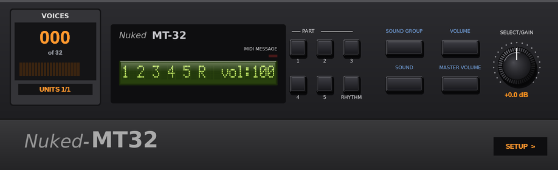
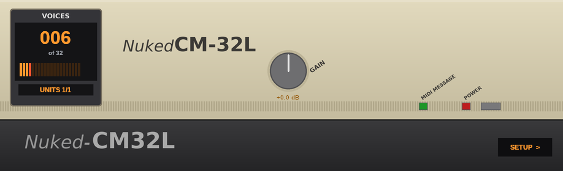
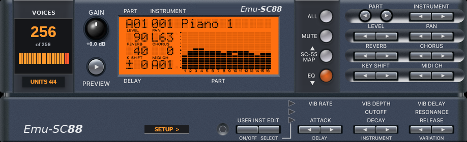
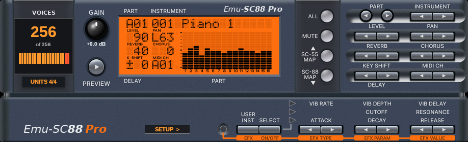
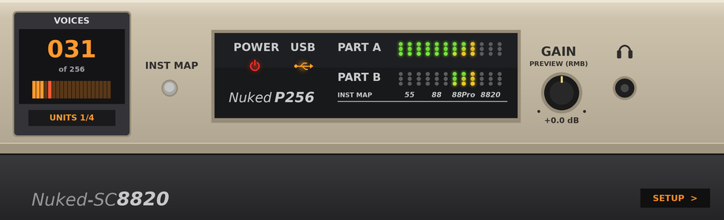
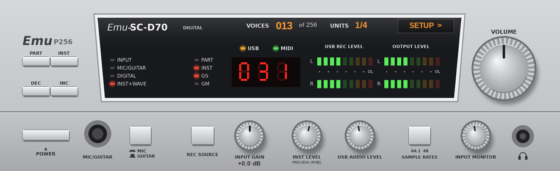
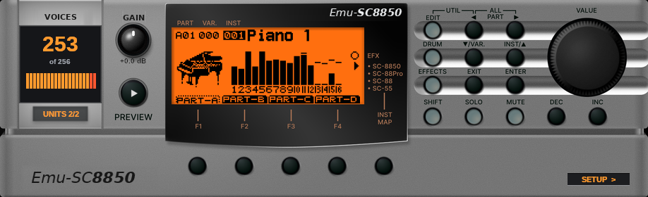

# Nuked SC-55 P256

Single-file **CLAP** and **VST2** plug-ins (Windows x64) for the Roland **MT-32 / CM-32L**, **SC-55 (v1.21)**, **SC-55mk2 (v1.01, with Capital Tone Fallback)**, **SC-88**, **SC-88 Pro**, **SC-8820** and **SC-8850**, built on the low-level emulation of [Nuked SC-55](https://github.com/nukeykt/Nuked-SC55) and [88emu](https://github.com/dsp56300/gearmulator). The original modules stop at 32 (MT-32, CM-32L), 24 (SC-55), 28 (SC-55mk2), 64 (SC-88, SC-88 Pro and SC-8820) or 128 (SC-8850) simultaneous voices. These plug-ins run several bit-identical emulator instances side by side and distribute the MIDI notes among them, which raises the limit to **64 voices** (MT-32 / CM-32L), **264 voices** (SC-55), **280 voices** (SC-55mk2), **256 voices** (SC-88, SC-88 Pro, SC-8820 and SC-8850) without changing how a single module sounds.

> [!IMPORTANT]
> The plug-ins aim to preserve an important part of DOS gaming history for all to enjoy. They are only intended for **personal use** (retro gaming, writing music as a hobby) and **research purposes**. **No ROM files are included in this repository.** Plug-ins that contain your ROMs (everything the builder produces) are for **private use only** and must not be shared.

## Quick start

The plug-ins are made from your own ROM files with the **patcher**; no compiler and no Python are needed.

1. Download the **patcher** for your system from the [Releases](https://github.com/NightFright2k19/Nuked-SC55-P256/releases) page (Windows, Linux, macOS Apple Silicon or macOS Intel). The newest Autobuild is at the top and marked **Latest**.
2. Put it in a folder together with your ROM files (subfolders are searched, file names do not matter; the files needed per model are listed in [Supported models and ROM sets](docs/roms.md)).
3. Start it, check the list of found models and click **Patch**.
4. Copy the results from `Plugins/CLAP/*.clap` and/or `Plugins/VST2/*.dll` to your plug-in folders (see [Using the plug-ins](#using-the-plug-ins)).

Everything for which a complete ROM set is found is built (MT-32 / CM-32L, SC-55 v1.21, SC-55mk2 v1.01, SC-88, SC-88 Pro, SC-8820, SC-8850). The patcher is not signed, so Windows SmartScreen and macOS Gatekeeper warn on the first start; see [Patcher and builder](docs/patcher.md) for how to start it anyway, for its self-update and for the command line options.

> [!NOTE]
> An original `Nuked-SC55.clap` is **not** needed. The P256 features are separate code and cannot be patched into the original binary. If you prefer to build everything yourself, see [Building from source](docs/building.md).

---

## The plug-ins

| Display name | File name (`.clap` / `.dll`) |
| --- | --- |
| Emu-MT32 (MT-32 / CM-32L) | `Emu-MT32` |
| Nuked-SC55 v1.21 | `Nuked-SC55_v121` |
| Nuked-SC55 MkII | `Nuked-SC55_MkII` |
| Emu-SC88 | `Emu-SC88` |
| Emu-SC88 Pro | `Emu-SC88_Pro` |
| Emu-SC8820 (with SC-D70 interface) | `Emu-SC8820` |
| Emu-SC8850 | `Emu-SC8850` |

CLAP and VST2 are the **same file** with two entry points. Windows x64 only for the plug-ins and their editor; the patcher also runs on Linux and macOS. Plug-in IDs, voice counts and the plug-in state are listed in the [plug-in reference](docs/plugins.md).

---

## The editor panel and the SETUP menu

Every plug-in has an editor panel (918 x 280 px) in the style of its hardware module. The LCD, the lamps and the switches of the module work as on the device; on top of that every panel shows the **VOICES** counter (sounding voices and units in use), a **GAIN** knob (-12 to +12 dB, 0 dB in the middle, double-click resets) and the **SETUP** button. Panel details per model: [Panels, controls and the SETUP menu](docs/panels.md) and [Models and engines](docs/models.md).

**SETUP** opens a menu with these entries (which ones appear depends on the model; the menu language follows Windows, German or English):

- **Max polyphony:** the voice limit of the plug-in. Units above the limit receive no new notes; a lower limit saves CPU.
- **Send Reset:** sends an MT-32, GM, GS (or GM2) reset to the module.
- **All notes off:** stops all sounding notes.
- **Tone map** (SC-88, SC-88 Pro, SC-8820, SC-8850): chooses the instrument map for all parts. **System Mode** (SC-88, SC-88 Pro): Mode 1 or Mode 2.
- **Device** (MT-32 / CM-32L): switches between MT-32 (old), MT-32 (new) and CM-32L.
- **Prevw Note** and **Interface Style:** note of the PREVIEW button (SC-88 Pro, SC-8820, SC-8850); panel style SC-8820 or SC-D70 (SC-8820).

All choices are stored in the project by your host. The full table of entries is in [Panels, controls and the SETUP menu](docs/panels.md#setup-menu).

---

## Using the plug-ins

- **Install the CLAP file** into one of the standard locations, for example `C:\Program Files\Common Files\CLAP\` or `%LOCALAPPDATA%\Programs\CLAP\`. **VST2:** copy the `.dll` into the VST2 folder of your host.
- **DAW:** load the plug-in as an instrument and send MIDI to it. For GM/GS/XG songs, a GS reset (or GM on) at the start is sent to all units as usual.
- **Falcosoft:** the plug-ins are meant to work with the [Falcosoft MIDI Player](https://falcosoft.hu/) and the Falcosoft VST MIDI Driver, which makes a VST instrument available as a system MIDI device (DOS games in DOSBox, Windows games). The MIDI Player is also a good second opinion for the LCD: its "Midi Text" and "Visualization" dialogs show the same text and bitmap messages.
- **Which one:** SC-55 v1.21 is the classic DOS game sound (Doom, Duke Nukem 3D and many others), SC-55mk2 with CTF is the later model with the SC-55 tones as fallback, SC-88 Pro offers the larger sound set and can switch back to the SC-55 and SC-88 maps.
- **Loudness:** every unit adds its notes to one mix. With very dense music, lower the host fader or use the SC-88 Pro volume knob.

---

## Documentation

- [Changes compared to Nuked-SC55-CLAP](docs/changes.md)
- [Supported models and ROM sets](docs/roms.md)
- [Plug-in reference](docs/plugins.md): names, IDs, plug-in state, environment variables
- [Models and engines](docs/models.md) and [Panels, controls and the SETUP menu](docs/panels.md)
- [Polyphony](docs/polyphony.md): how it works, Display SysEx, Capital Tone Fallback
- [Patcher and builder](docs/patcher.md)
- [Building from source](docs/building.md)
- [Performance and memory](docs/performance.md)
- [Verification](docs/verification.md)
- [Known limitations and issues](docs/known-issues.md)
- [Development and test tools](docs/development.md)

**Version history:** news about new versions is in the release notes of each [Autobuild](https://github.com/NightFright2k19/Nuked-SC55-P256/releases).

---

## Credits and license

- **NukeYKT** - [Nuked-SC55](https://github.com/nukeykt/Nuked-SC55), the low-level SC-55 emulation this project is built on
- **John Novak** - [Nuked-SC-55-CLAP](https://github.com/johnnovak/Nuked-SC55-CLAP), the CLAP plug-in this project forked from
- **dsp56300** - [Gearmulator](https://github.com/dsp56300/gearmulator), including the 88emu core used for the MT-32, CM-32L, SC-88, SC-88 Pro, SC-8820 and SC-8850
- **shingo45endo** - [SC55MK2-CTF-Patcher](https://github.com/shingo45endo/sc55mk2-ctf-patcher), tool to modify the SC-55mkII firmware for CTF support
- **Falcosoft** - Falcosoft MIDI Player and Falcosoft VST MIDI Driver ([falcosoft.hu](https://falcosoft.hu/))
- **Magnific** - the patcher icon is a VST icon from [magnific.com/icons/vst](https://www.magnific.com/icons/vst)
- **Roland** - [Roland](https://www.roland.com), the MT-32, the CM-32L and the SC-55, SC-55mk2, SC-88, SC-88 Pro, SC-8820 and SC-8850 sound modules

### License

This project is licensed under the **GNU General Public License v3.0** (see [LICENSE](LICENSE.md).

Parts of the code come from other projects and keep their own notices:

- The files of the emulation core in `src/nuked-sc55/` carry the notice of nukeykt: redistribution is allowed, but not for sale and not in a commercial product or activity, and modified redistributions must include the complete source code.
- The original Nuked-SC55-CLAP plug-in code is distributed under the GPL v2.0 or later, as stated in its README.
- 88emu and the SC-88 Pro panel art are by The Usual Suspects and part of Gearmulator (GPLv3).
- The CLAP headers in `include/clap` are from the CLAP project. The VST2 interface in `src/vst2/vst2_abi.h` is an independent description of the binary interface and contains no Steinberg SDK code ("VST" is a trademark of Steinberg Media Technologies GmbH).

**ROMs are not part of this repository and are not covered by this license.** They are the property of Roland. Plug-ins built with the builder or with embedded ROMs contain them and are for private use only.

This software comes with no warranty (see sections 15 and 16 of the license). "Roland", "Sound Canvas" and the model names are trademarks of their owners and are only used to say which hardware is emulated.
